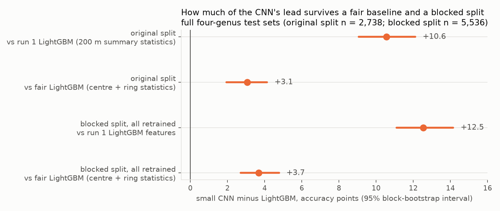

# Tree genus from Sentinel-2 and aerial images, and what the error does to wood volume

Code, results and write-ups for an experiment on the [TreeSatAI Benchmark Archive](https://doi.org/10.5281/zenodo.6780578): classifying spruce (*Picea*), pine (*Pinus*), beech (*Fagus*) and oak (*Quercus*) from open imagery, and turning the remaining classification error into errors of wood volume per genus for synthetic regions.

The experiments were run unattended by an AI coding agent (Claude Code) in two rounds, following the brief and rules in [`docs/`](docs/), and were then reviewed. Every number in the result files is produced by the code in this repository.

## Main findings

| | |
|---|---|
| Run 1 | A small CNN on 12 × 20 × 20 Sentinel-2 patches (89.5%) beat LightGBM on 200 m summary statistics (78.9%) by 10.6 accuracy points on the four-genus test set. |
| Fair baseline | LightGBM on separate statistics of the labelled 60 m centre and the surrounding ring reaches 86.4%; the CNN's lead shrinks to 3.1 points (95% CI 1.9 to 4.2). |
| Blocked split | Holding out whole 2 km blocks, the CNN still leads the fair baseline by 3.7 points (2.7 to 4.8). Patch coordinates alone give 71.4% on the original split and 54-57% on blocked splits. |
| Volume | Counting predicted labels gives small area errors only when the region has the training genus mix. With 2% oak, counting overstates oak volume by 182.9% (CNN); an EM prior-shift correction brings the error down to an RMSE of 13.7%. Volumes and regions are placeholders. |

Details: [RESULTS.md](RESULTS.md) (run 1), [RESULTS_V2.md](RESULTS_V2.md) (run 2: fair baseline, blocked split, five area estimators, label purity), [DECISIONS.md](DECISIONS.md) (every choice made without a human), [STATUS.md](STATUS.md) (run log).



## Reproduce

Python 3.11 or newer. Windows paths shown; on Linux/macOS use `.venv/bin/python`.

```bash
python -m venv .venv && .venv/Scripts/python -m pip install -r requirements.txt
.venv/Scripts/python src/download.py      # about 7.6 GB from Zenodo into data/, md5-checked, 8 GB cap
.venv/Scripts/python src/run_all.py       # run 1: tests, caches, models 1-3, evaluation, volume step
.venv/Scripts/python src/run_all_v2.py    # run 2: all follow-up checks
```

On a CPU-only laptop (Intel i7-11850H) run 1 took about 80 minutes and run 2 about 70 minutes. Exact package versions are in `requirements-lock.txt`. Training is not bit-for-bit deterministic across machines, so a rerun may differ in the last digits.

Without downloading anything, the volume analyses rerun from the saved predictions in `results/`:

```bash
.venv/Scripts/python src/volume_step.py          # run 1 volume step
.venv/Scripts/python src/v2_stage1_volume.py     # run 2 five-estimator simulation (about 20 min)
```

Growing stock per genus is set in `volumes.yaml` and the synthetic genus mixes in `regions.yaml`; both hold **placeholder** values.

## Layout

```
src/            experiment code (run 1: download, data, features, train_m*, evaluate, volume_step;
                run 2: v2_* scripts, quantify.py, blocks.py, coord_baselines.py)
tests/          unit tests for metrics, volume and share estimators, features, spatial blocks
results/        run 1 outputs: predictions, metrics, tables, figures
results_v2/     run 2 outputs: tables, figures, predictions of all variants, blocked splits
docs/           the brief and the rules the agent worked under
```

`results_v2/stage1_volume_replicates.parquet` (per-replicate errors, 5 MB) is not included; `src/v2_stage1_volume.py` regenerates it.

## Data and citation

The data are not included. TreeSatAI Benchmark Archive, licensed CC BY 4.0:

- Schulz, C., Ahlswede, S., Gava, C., Helber, P., Bischke, B., Arias, F., Förster, M., Hees, J., Demir, B., and Kleinschmit, B. (2022). TreeSatAI Benchmark Archive for Deep Learning in Forest Applications, version 1.0.1. Zenodo. https://doi.org/10.5281/zenodo.6780578
- Ahlswede, S., et al. (2023). TreeSatAI Benchmark Archive: a multi-sensor, multi-label dataset for tree species classification in remote sensing. *Earth System Science Data*, 15, 681–695. https://doi.org/10.5194/essd-15-681-2023

## Licence

Code and documentation: MIT, see [LICENSE](LICENSE).
