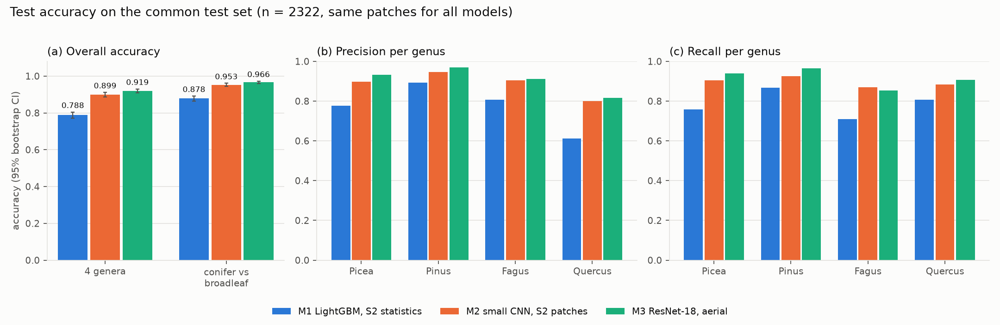
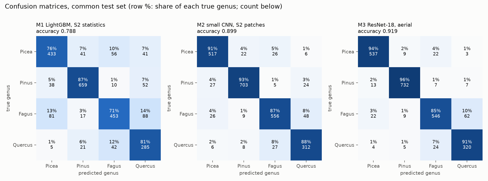
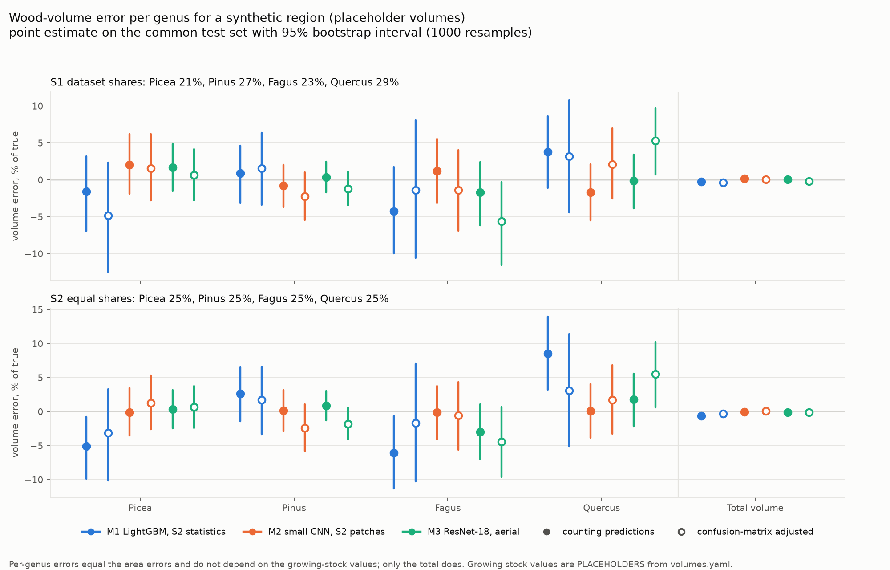

# RESULTS

All three models ran to completion on the first complete run. No model was retuned after seeing test results. Fallback level 1 was used (details under "Fallback level and deviations"). Every number below comes from files in `results/`. The full tables at the end are copied verbatim from `results/tables.md`, which `src/make_tables.py` generates. **All volume figures use placeholder volumes** (`volumes.yaml`, `placeholder: true`).

## Short answers

**1. Do the deep models beat LightGBM on the same test split? Yes, clearly.**
On the common test set (2,322 patches, scored identically for all three models):

| model | accuracy (95% CI) | weighted precision | conifer vs broadleaf |
|---|---|---|---|
| M1 LightGBM, S2 summary statistics | 78.8% (77.0-80.4%) | 79.8% | 87.8% |
| M2 small CNN, S2 patches | 89.9% (88.7-91.1%) | 90.1% | 95.3% |
| M3 ResNet-18, aerial (20 cm photos downscaled to 128 px) | 91.9% (90.8-93.0%) | 92.1% | 96.6% |

- Paired bootstrap differences: M2 minus M1 is **+11.1 points** (95% CI +9.3 to +12.8); M3 minus M1 is **+13.1 points** (+11.4 to +15.0); M3 minus M2 is **+2.0 points** (+0.7 to +3.4).
- On the full four-genus test set (2,738 patches, including Q. petraea and Q. rubra), M2 beats M1 by +10.6 points (+9.0 to +12.0): 89.5% vs 78.9%.

Most of the gain comes from the *method*, not from the *imagery*. A 0.29 M-parameter CNN on the same 10 m Sentinel-2 patches closes 11 of the 13 points. The aerial photos, used here downscaled to 128 px, add only 2 more. The small CNN trained in 11.0 min on a laptop CPU.

So "does this need deep learning?": on this split, hand-made per-band statistics with LightGBM leave about 11 points of accuracy unused, and a small CNN on the same satellite data recovers them. The likely source is the spatial pattern inside the 200 m window, which summary statistics throw away; this run did not test that separately. These results are not comparable to the dataset paper's figures cited in the brief, which are for many more classes.

**2. Does the accuracy gap change the volume estimate, or disappear after the adjustment?**
The gap shows up in volume much less than in accuracy, and after the adjustment it is gone. The point estimates even reverse (M3 ends up with the largest mean error), but the bootstrap intervals of all three models overlap.

Mean absolute per-genus volume error, common test set (placeholder volumes; per-genus errors do not depend on the growing-stock values):

| | S1 dataset shares, counting | S1, adjusted | S2 equal shares, counting | S2, adjusted |
|---|---|---|---|---|
| M1 LightGBM | 2.6% | 2.7% | 5.6% | 2.4% |
| M2 small CNN | 1.4% | 1.8% | 0.1% | 1.5% |
| M3 ResNet-18 | 1.0% | 3.2% | 1.5% | 3.1% |

- **Counting predictions:** a 79%-accurate model does not misstate area by 21%, because omissions and commissions partly cancel. In S1, M1's per-genus errors range from −4.2% (beech) to +3.8% (oak), and none of its S1 bootstrap intervals excludes zero. They grow when the region's mix differs from what M1's errors happen to balance: in S2, M1 misstates spruce by −5.1% [−9.9%, −0.8%], beech by −6.1% and oak by +8.5% [+3.3%, +13.9%]. M2's and M3's counted errors are within ±3% and all their intervals include zero.
- **Confusion-matrix adjustment:**
  - It helps the weak model where its counting bias is large: M1 in S2 drops from 5.6% to 2.4%, and on the full test set from 5.1% to 1.7% in S2 and from 3.0% to 1.5% in S1.
  - For the accurate models it adds noise: M2 1.4% → 1.8% (S1); M3 1.0% → 3.2% (S1) and 1.5% → 3.1% (S2).
  - The reason is that the adjustment inverts the validation matrix, so it only helps if that matrix matches the test behaviour. For M3 the Fagus→Quercus rate is 7.6% on validation but 9.7% on test, and Quercus→Fagus is 10.3% vs 6.8% (`results/volume_meta.json`). With 310 to 759 patches per genus in each set, differences of this size are consistent with sampling noise, and they are as large as the bias being corrected. Inverting the matrix turns them into +5.3% oak and −5.6% beech in S1.
  - After adjustment, all three models land at 1.5-3.2% mean absolute genus error, with overlapping intervals. The adjusted intervals are also too narrow, because the validation matrix is held fixed in the bootstrap.
- **Total volume:** every model and estimator misstates it by at most 0.6%. Errors between genera largely cancel, and the placeholder growing stocks are close to each other (300-400 m³/ha). With real values that differ more between genera, the total error could be larger.

**3. The sentence (common test set, scenario S1, counting predictions, placeholder volumes):**
A classifier with 78.8% accuracy (M1 LightGBM) misstates spruce volume by −1.6% (95% bootstrap interval −6.9% to +3.2%) (placeholder volumes).

The same for the other models: 89.9% accuracy (M2) gives +2.0% (−1.9% to +6.2%), and 91.9% accuracy (M3) gives +1.7% (−1.5% to +4.8%). The per-genus percentage is the same for any growing-stock value, because it equals the area error. Under equal shares (S2), M1 misstates spruce by −5.1%.

## Figures

*Figure 1. Accuracy (4 genera and conifer vs broadleaf) with 95% bootstrap CIs, and per-genus precision and recall, on the common test set (n = 2,322).*

*Figure 2. Confusion matrices on the common test set: row percentages (share of each true genus) and counts. M1's main errors are beech ↔ oak and beech ↔ spruce. For M2 and M3 the remaining errors are mostly beech ↔ oak.*

*Figure 3. Wood-volume error per genus and in total, for each model, by counting predictions (filled) and after confusion-matrix adjustment (open). Point estimate with 95% bootstrap interval (1,000 resamples of the common test set). Top: S1 dataset shares; bottom: S2 equal shares. **Placeholder volumes.** `results/fig3_volume_error_full.png` shows the same for models 1 and 2 on the full test set.*

## Diagnostic: spatial proximity of test and training patches

The split lists carry no stand IDs. 1,951 of the 2,738 full-set test patches (1,587 of the 2,322 common-set patches) have a training patch whose centre lies within 200 m, so their 200 m Sentinel-2 windows overlap a training window. This could favour a CNN that memorises pixels. The check (table G, `results/spatial_check.csv`) does not support that:

- **200-600 m from the nearest training patch** (no window overlap; 706 common-set patches): M1 76.6%, M2 89.7%, M3 91.2%.
- **Under 200 m:** M1 80.4%, M2 90.3%, M3 92.4%.

All models are a little better close to training patches, and M2's lead does not shrink when windows stop overlapping. Only 29 common-set test patches lie more than 600 m from any training patch, too few to measure accuracy on truly independent areas. The test split is therefore not spatially independent of training, and every absolute accuracy here is likely higher than on a new region.

## Fallback level and deviations from the brief

- **Fallback level 1** (DECISIONS D6). I downloaded Sentinel-2, labels and split lists, and aerial files starting with the most frequent species of each genus: Picea abies, Pinus sylvestris, Fagus sylvatica and Quercus robur, plus the small Pinus nigra and P. strobus files that still fitted. The total was 7.663 GB including the 47 MB ResNet weights (`results/download_ledger.csv`), under the 8 GB cap, and all md5 checks passed. Quercus petraea and Q. rubra aerial files were left out because they would have broken the cap.
- **Test set for the three-way comparison:** the "common" test set, i.e. test patches of the downloaded species, instead of the full four-genus test split, so that model 3 is scored on the same patches as models 1 and 2 (D7). It has no Q. petraea or Q. rubra (353 oak test patches instead of 769). Models 1 and 2 are also reported on the full test set; their accuracy differs by under 0.5 points between the two sets.
- **Model 3** was a full fine-tune at 128 px (area-downscaled from 304 px, about 47 cm/pixel). It trained on at most 3,000 patches per genus (11,790 in total), for 12 epochs, on CPU, sized by the timed pilot (D11, `results/pilot_timing.json`). The first convolution was widened to 4 bands (NIR, G, B, R), no band dropped; the NIR filters started as the mean of the RGB filters (D10).
- **Labels:** the genus of the file-name species, the archive's single label (D3). The validation set is 10% of the training list, drawn per species (D8).
- **Sentinel-2 band order** was inferred, because the files carry no band names (D5). It matters only for model 1's NDVI, NDRE and NDMI. 48 S2 patches of 21 px were cropped to 20 px (D9).
- **Volume step:**
  - The region is treated as large, using the expected predicted area from the test confusion matrix, so region-level sampling noise is ignored.
  - Adjusted estimates clip negative areas to 0 and keep the total area.
  - The validation matrix is held fixed in the bootstrap.
  - Scenario S1 uses the genus shares of all 27,656 four-genus patches in the archive: Picea 20.9%, Pinus 27.2%, Fagus 23.4%, Quercus 28.6%.
- **Added** a spatial-proximity diagnostic not asked for in the brief (D12). It changed nothing in the main results.
- **Compute:** CPU only, no GPU available (D2). Training used 71.8 min in total for the three models (`results/run_facts.json`), inside the 2 h budget.

## Limitations

- **One German state** (Lower Saxony). Results may not transfer to other regions, site conditions or management.
- **Summer imagery only.** Single-season aerial photos and Sentinel-2 scenes, so phenology is not used.
- **Patches from administratively labelled stands** (forest inventory polygons), not field-checked trees. Among the four-genus patches, 3.9% have a file-name genus that differs from the largest genus share in the archive's own label JSON (6.8% across all 50,381 patches; `results/run_facts.json`). Mixed stands carry their main species as the label.
- **Synthetic region.** The volume step assumes the test-set error rates hold in the region, treats every stand as pure, and ignores the region's own sampling noise.
- **Placeholder volumes.** The growing stock values are illustrative. Per-genus relative errors do not depend on them; total-volume errors do, and are small here partly because the placeholders are similar across genera.
- **Not spatially independent.** Test patches are mostly within a few hundred metres of training patches (see the diagnostic), so accuracies are likely optimistic for new areas, for all models.
- **Partial oak coverage for model 3:** it saw only Quercus robur.
- **Adjustment uncertainty is understated,** because the validation matrix is not resampled.
- **One run per model, one seed.** The 2.0-point gap between M2 and M3 covers test-set sampling (M3 is ahead in 99.7% of paired resamples), but not training randomness; repeated runs would be needed for that.
- **CPU budget:** model 3 used 128 px and 12 epochs. A GPU run at full resolution might widen the aerial model's lead.

## Files

- Predictions: `results/predictions_m1_lgbm.parquet`, `results/predictions_m2_cnn.parquet`, `results/predictions_m3_resnet18.parquet` (validation and test patches, class probabilities).
- Index and splits: `results/index.parquet`.
- Metrics: `results/metrics.json`, `results/metrics_table.csv`.
- Volume step: `results/volume_summary*.csv`, `results/volume_bootstrap*.parquet`, `results/volume_meta*.json`.
- Run logs: `results/run_*.json` (training histories), `logs/`.
- Diagnostic: `results/spatial_check.csv`, `results/patch_centres.parquet`.

## Full tables (generated: `results/tables.md`)

### A. Overall test scores

| test set | model | n | accuracy (95% CI) | weighted precision | macro F1 | conifer vs broadleaf accuracy (95% CI) |
|---|---|---|---|---|---|---|
| common | M1 LightGBM, S2 statistics | 2322 | 78.8% (77.0% to 80.4%) | 79.8% | 0.775 | 87.8% (86.5% to 89.1%) |
| common | M2 small CNN, S2 patches | 2322 | 89.9% (88.7% to 91.1%) | 90.1% | 0.891 | 95.3% (94.4% to 96.1%) |
| common | M3 ResNet-18, aerial | 2322 | 91.9% (90.8% to 93.0%) | 92.1% | 0.911 | 96.6% (95.8% to 97.3%) |
| full | M1 LightGBM, S2 statistics | 2738 | 78.9% (77.5% to 80.4%) | 78.9% | 0.784 | 87.9% (86.7% to 89.1%) |
| full | M2 small CNN, S2 patches | 2738 | 89.5% (88.3% to 90.6%) | 89.5% | 0.894 | 95.4% (94.6% to 96.2%) |

### B. Paired accuracy differences (same test patches, 1,000 paired bootstrap resamples)

| test set | comparison | difference in accuracy | 95% CI | share of resamples where the first model is better |
|---|---|---|---|---|
| common | M2 small CNN, S2 patches minus M1 LightGBM, S2 statistics | +11.1% | +9.3% to +12.8% | 1.000 |
| common | M3 ResNet-18, aerial minus M1 LightGBM, S2 statistics | +13.1% | +11.4% to +15.0% | 1.000 |
| common | M3 ResNet-18, aerial minus M2 small CNN, S2 patches | +2.0% | +0.7% to +3.4% | 0.997 |
| full | M2 small CNN, S2 patches minus M1 LightGBM, S2 statistics | +10.6% | +9.0% to +12.0% | 1.000 |

### C. Per-genus precision and recall, common test set

| model | Picea P | Picea R | Pinus P | Pinus R | Fagus P | Fagus R | Quercus P | Quercus R | conifer P | conifer R | broadleaf P | broadleaf R |
|---|---|---|---|---|---|---|---|---|---|---|---|---|
| M1 LightGBM, S2 statistics | 0.777 | 0.758 | 0.893 | 0.868 | 0.807 | 0.709 | 0.612 | 0.807 | 0.904 | 0.880 | 0.845 | 0.875 |
| M2 small CNN, S2 patches | 0.898 | 0.905 | 0.947 | 0.926 | 0.906 | 0.870 | 0.800 | 0.884 | 0.963 | 0.954 | 0.939 | 0.951 |
| M3 ResNet-18, aerial | 0.932 | 0.940 | 0.970 | 0.964 | 0.912 | 0.854 | 0.816 | 0.907 | 0.970 | 0.971 | 0.961 | 0.960 |

### D. Training runs (device, time, selected epoch)

| model | device | training patches | training time | epochs run | selected epoch / rounds | best validation accuracy |
|---|---|---|---|---|---|---|
| M1 LightGBM, S2 statistics | cpu | 22425 | 0.2 min | - | 270 | - |
| M2 small CNN, S2 patches | cpu | 22425 | 11.0 min | 40 | 37 | 89.8% |
| M3 ResNet-18, aerial | cpu | 11790 | 60.6 min | 12 | 12 | 91.0% |

### E. Volume error in % of true volume, common test set, all three models (placeholder volumes)

Point estimate on the test set, with the 95% bootstrap interval in brackets. 'count' = area by counting predictions; 'adjusted' = after confusion-matrix adjustment. The validation matrix used for the adjustment is held fixed, so adjusted intervals leave out validation-set noise and are too narrow. The last column averages |error| over the four genera. Bootstrapping an absolute value biases it upward, so its interval can exclude a point estimate near zero; read it as the spread of the error size, not as a confidence interval.

| scenario | model | estimator | Picea | Pinus | Fagus | Quercus | total volume | mean abs. genus error |
|---|---|---|---|---|---|---|---|---|
| S1 dataset shares | M1 LightGBM, S2 statistics | count | -1.6% [-6.9%, +3.2%] | +0.9% [-3.1%, +4.6%] | -4.2% [-9.9%, +1.7%] | +3.8% [-1.1%, +8.6%] | -0.2% [-0.6%, +0.0%] | 2.6% [1.1%, 5.7%] |
| S1 dataset shares | M1 LightGBM, S2 statistics | adjusted | -4.8% [-12.5%, +2.3%] | +1.6% [-3.4%, +6.4%] | -1.4% [-10.5%, +8.1%] | +3.2% [-4.4%, +10.8%] | -0.4% [-0.8%, +0.0%] | 2.7% [1.2%, 7.7%] |
| S1 dataset shares | M2 small CNN, S2 patches | count | +2.0% [-1.9%, +6.2%] | -0.8% [-3.6%, +2.1%] | +1.2% [-3.1%, +5.5%] | -1.7% [-5.5%, +2.1%] | +0.2% [-0.1%, +0.4%] | 1.4% [0.6%, 3.6%] |
| S1 dataset shares | M2 small CNN, S2 patches | adjusted | +1.6% [-2.8%, +6.2%] | -2.3% [-5.4%, +1.0%] | -1.4% [-6.9%, +4.0%] | +2.1% [-2.6%, +7.0%] | +0.1% [-0.2%, +0.3%] | 1.8% [0.8%, 5.0%] |
| S1 dataset shares | M3 ResNet-18, aerial | count | +1.7% [-1.5%, +4.8%] | +0.4% [-1.7%, +2.5%] | -1.7% [-6.1%, +2.4%] | -0.2% [-3.8%, +3.5%] | +0.0% [-0.2%, +0.3%] | 1.0% [0.4%, 3.3%] |
| S1 dataset shares | M3 ResNet-18, aerial | adjusted | +0.7% [-2.8%, +4.2%] | -1.2% [-3.5%, +1.1%] | -5.6% [-11.5%, -0.3%] | +5.3% [+0.7%, +9.7%] | -0.2% [-0.4%, +0.1%] | 3.2% [1.2%, 6.0%] |
| S2 equal shares | M1 LightGBM, S2 statistics | count | -5.1% [-9.9%, -0.8%] | +2.6% [-1.4%, +6.5%] | -6.1% [-11.3%, -0.6%] | +8.5% [+3.3%, +13.9%] | -0.6% [-0.9%, -0.3%] | 5.6% [3.1%, 8.5%] |
| S2 equal shares | M1 LightGBM, S2 statistics | adjusted | -3.1% [-10.1%, +3.3%] | +1.7% [-3.3%, +6.6%] | -1.7% [-10.2%, +7.0%] | +3.1% [-5.1%, +11.4%] | -0.3% [-0.7%, +0.1%] | 2.4% [1.0%, 7.2%] |
| S2 equal shares | M2 small CNN, S2 patches | count | -0.1% [-3.5%, +3.5%] | +0.1% [-2.9%, +3.2%] | -0.1% [-4.1%, +3.7%] | +0.1% [-3.9%, +4.1%] | -0.0% [-0.2%, +0.2%] | 0.1% [0.4%, 3.0%] |
| S2 equal shares | M2 small CNN, S2 patches | adjusted | +1.3% [-2.6%, +5.3%] | -2.4% [-5.8%, +1.0%] | -0.6% [-5.6%, +4.3%] | +1.7% [-3.3%, +6.8%] | +0.1% [-0.2%, +0.4%] | 1.5% [0.7%, 4.6%] |
| S2 equal shares | M3 ResNet-18, aerial | count | +0.3% [-2.4%, +3.1%] | +0.8% [-1.3%, +3.0%] | -3.0% [-7.0%, +1.0%] | +1.8% [-2.1%, +5.6%] | -0.1% [-0.3%, +0.1%] | 1.5% [0.4%, 3.7%] |
| S2 equal shares | M3 ResNet-18, aerial | adjusted | +0.7% [-2.4%, +3.8%] | -1.8% [-4.1%, +0.6%] | -4.4% [-9.6%, +0.7%] | +5.5% [+0.6%, +10.2%] | -0.1% [-0.4%, +0.1%] | 3.1% [1.2%, 5.9%] |

**Spruce sentences (common test set, all three models, scenario S1, counting predictions (placeholder volumes)):**

- A classifier with 78.8% accuracy (M1 LightGBM, S2 statistics) misstates spruce volume by -1.6% (95% bootstrap interval -6.9% to +3.2%) (placeholder volumes).
- A classifier with 89.9% accuracy (M2 small CNN, S2 patches) misstates spruce volume by +2.0% (95% bootstrap interval -1.9% to +6.2%) (placeholder volumes).
- A classifier with 91.9% accuracy (M3 ResNet-18, aerial) misstates spruce volume by +1.7% (95% bootstrap interval -1.5% to +4.8%) (placeholder volumes).

### E_full. Volume error in % of true volume, full test set, models 1 and 2 (placeholder volumes)

Point estimate on the test set, with the 95% bootstrap interval in brackets. 'count' = area by counting predictions; 'adjusted' = after confusion-matrix adjustment. The validation matrix used for the adjustment is held fixed, so adjusted intervals leave out validation-set noise and are too narrow. The last column averages |error| over the four genera. Bootstrapping an absolute value biases it upward, so its interval can exclude a point estimate near zero; read it as the spread of the error size, not as a confidence interval.

| scenario | model | estimator | Picea | Pinus | Fagus | Quercus | total volume | mean abs. genus error |
|---|---|---|---|---|---|---|---|---|
| S1 dataset shares | M1 LightGBM, S2 statistics | count | +1.8% [-3.2%, +7.3%] | +0.7% [-2.8%, +4.2%] | -6.2% [-11.2%, -1.3%] | +3.1% [-0.9%, +7.4%] | -0.1% [-0.4%, +0.2%] | 3.0% [1.2%, 5.8%] |
| S1 dataset shares | M1 LightGBM, S2 statistics | adjusted | +0.5% [-6.8%, +8.6%] | +2.6% [-1.8%, +7.1%] | -0.7% [-8.4%, +7.4%] | -2.3% [-8.0%, +4.0%] | +0.0% [-0.4%, +0.4%] | 1.5% [0.9%, 5.9%] |
| S1 dataset shares | M2 small CNN, S2 patches | count | +2.0% [-1.6%, +5.6%] | -0.9% [-3.6%, +1.7%] | +2.2% [-1.7%, +6.1%] | -2.4% [-5.6%, +0.9%] | +0.2% [-0.0%, +0.4%] | 1.9% [0.7%, 3.9%] |
| S1 dataset shares | M2 small CNN, S2 patches | adjusted | +1.0% [-3.0%, +5.1%] | -1.3% [-4.4%, +1.6%] | +2.5% [-2.3%, +7.4%] | -1.6% [-5.6%, +2.6%] | +0.2% [-0.1%, +0.4%] | 1.6% [0.7%, 4.1%] |
| S2 equal shares | M1 LightGBM, S2 statistics | count | -2.6% [-7.1%, +2.5%] | +2.4% [-1.4%, +6.4%] | -7.7% [-12.6%, -2.9%] | +7.9% [+3.4%, +12.8%] | -0.5% [-0.8%, -0.2%] | 5.1% [2.9%, 7.6%] |
| S2 equal shares | M1 LightGBM, S2 statistics | adjusted | +0.8% [-5.8%, +8.2%] | +2.7% [-2.1%, +7.6%] | -1.1% [-8.7%, +6.6%] | -2.4% [-8.9%, +4.9%] | +0.0% [-0.4%, +0.4%] | 1.7% [1.0%, 6.0%] |
| S2 equal shares | M2 small CNN, S2 patches | count | -0.1% [-3.4%, +3.2%] | +0.1% [-2.8%, +2.9%] | +0.7% [-3.1%, +4.4%] | -0.6% [-4.1%, +3.0%] | +0.0% [-0.2%, +0.3%] | 0.4% [0.4%, 2.8%] |
| S2 equal shares | M2 small CNN, S2 patches | adjusted | +0.8% [-2.8%, +4.6%] | -1.5% [-4.7%, +1.7%] | +2.6% [-2.0%, +7.1%] | -2.0% [-6.2%, +2.6%] | +0.2% [-0.1%, +0.4%] | 1.7% [0.7%, 4.2%] |

**Spruce sentences (full test set, models 1 and 2, scenario S1, counting predictions (placeholder volumes)):**

- A classifier with 78.9% accuracy (M1 LightGBM, S2 statistics) misstates spruce volume by +1.8% (95% bootstrap interval -3.2% to +7.3%) (placeholder volumes).
- A classifier with 89.5% accuracy (M2 small CNN, S2 patches) misstates spruce volume by +2.0% (95% bootstrap interval -1.6% to +5.6%) (placeholder volumes).

### G. Accuracy by distance from a test patch to the nearest training patch (Chebyshev distance between patch centres)

200 m Sentinel-2 windows overlap when the distance is under 200 m.

common test set:

| distance band | n | M1 LightGBM, S2 statistics | M2 small CNN, S2 patches | M3 ResNet-18, aerial |
|---|---|---|---|---|
| 0-200 m | 1587 | 80.4% | 90.3% | 92.4% |
| 200-600 m | 706 | 76.6% | 89.7% | 91.2% |
| 600-2000 m | 26 | 46.2% | 73.1% | 84.6% |
| 2000-inf m | 3 | 33.3% | 100.0% | 66.7% |
| all | 2322 | 78.8% | 89.9% | 91.9% |

full test set:

| distance band | n | M1 LightGBM, S2 statistics | M2 small CNN, S2 patches |
|---|---|---|---|
| 0-200 m | 1951 | 80.3% | 89.8% |
| 200-600 m | 752 | 76.5% | 89.1% |
| 600-2000 m | 31 | 54.8% | 77.4% |
| 2000-inf m | 4 | 50.0% | 100.0% |
| all | 2738 | 78.9% | 89.5% |
